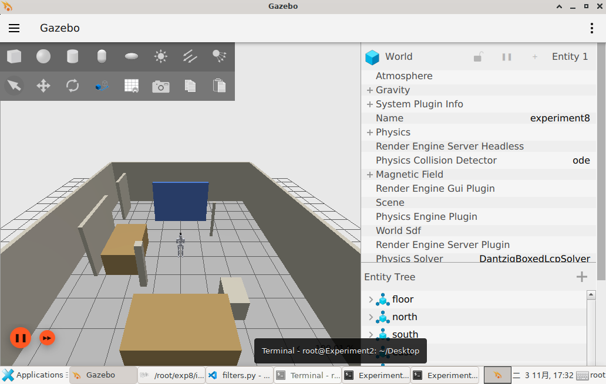
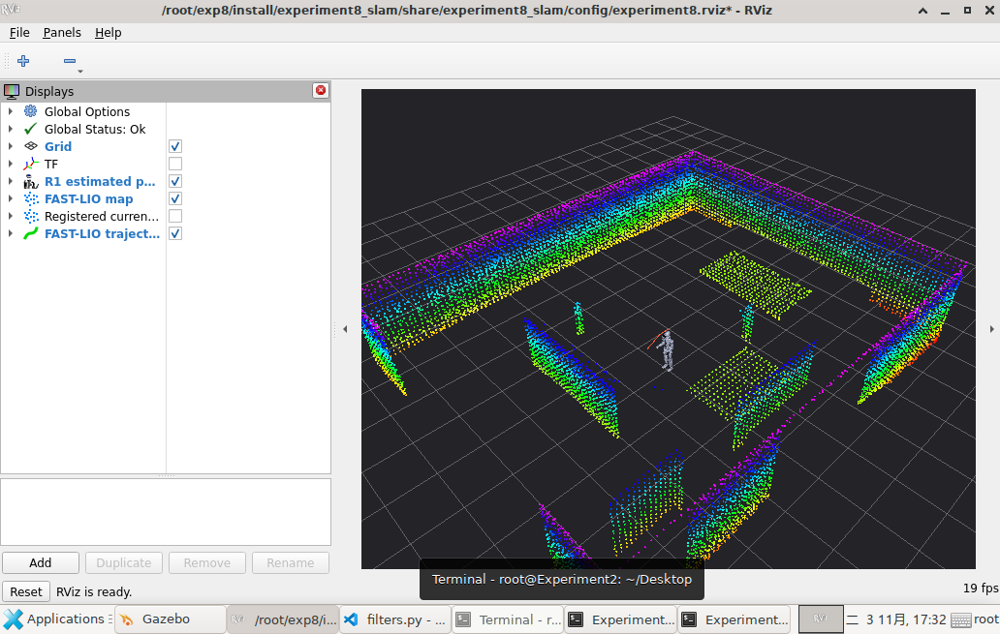
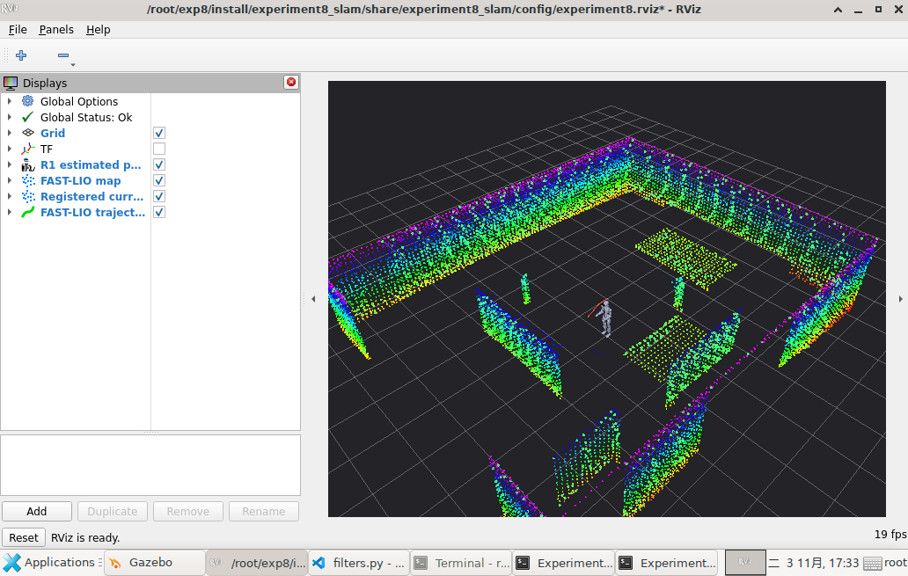

# 实验8平台验证记录

验证日期：2026年11月3日。结论：完成编译、三组参数运行、图形界面、地图保存、参数导出及数据录制检查，全部通过。验证结果已随工程发布至GitHub。

## 验证环境与范围

- 教学平台 Experiment2，Ubuntu 22.04、ROS 2 Humble、Gazebo Fortress 6；SSH进入用户指定的虚拟机，在 `/root/exp8` 独立构建。
- 使用与实验7相同的R1模型、Mid-360扫描方向表、点云与IMU仿真插件。实验8增加两处低平台，为高度估计提供水平面约束；未修改实验7工作区。
- 五个功能包完成构建：`experiment5_depth`、`experiment7_lidar`、`livox_ros_driver2`、`fast_lio`、`experiment8_slam`。
- 本次使用已完成实验7验证的虚拟机，未还原成全新系统镜像。实际执行了依赖安装脚本；对教学包另做全新目录解压、离线资源校验和运行源码一致性检查，未在解压目录进行第二次完整编译。

## 实际验证内容

| 项目 | 实测结果 |
| --- | --- |
| 点云适配 | 对40组原始点云与Livox消息逐点核对，坐标、点数、强度、tag、line、帧起始时间和纳秒偏移保持一致 |
| IMU时序 | 固定预留2秒仿真启动阶段并单独记录；其后30帧扫描均有IMU覆盖，最终GUI组最大采样间隔约5毫秒 |
| 初始化与建图 | 出现IMU初始化完成信息，持续发布里程计、当前帧、地图和轨迹 |
| 控制与停车 | 按仿真时间执行前进、转向、倒退和返回；结束发送零速度 |
| 参考坐标 | TF链完整，关闭真值到机身的动态TF；FAST-LIO只订阅点云和IMU，不订阅真值 |
| 地图文件 | 保存服务返回成功；二进制PCD头部、POINTS、数据长度和全部XYZ有限值检查通过 |
| 参数与记录 | 三组实际导出的体素参数分别为0.08、0.12、0.24；rosbag包含全部9个要求话题 |
| 离线教学包 | CRC与185个依赖文件校验通过，94个运行源码及资源文件与实测工程一致 |

最终GUI组按时间戳匹配了140个估计与真值样本。只在静止起点做一次平面坐标对齐，后续不重新拟合：平面RMSE约0.51厘米，最大平面误差约0.91厘米，最大偏航误差约0.00122弧度；高度相对初始化原点的最大偏移约1.10厘米。

最终GUI地图话题样本包含8133点，点到已知场景表面的距离95分位数约2.64厘米；随后保存的PCD包含8191点，文件262359字节。二者采样时刻不同，点数可以略有变化。

## 降采样比较

三组均重新启动场景，保持地图体素0.12米，执行相同的仿真时长和运动序列。当前帧点数采用各组运行过程的中位数。

| 当前帧体素/米 | 当前帧点数中位数 | 地图话题采样点数 | 平面RMSE/厘米 | 高度最大偏移/厘米 | 结果 |
| --- | --- | --- | --- | --- | --- |
| 0.08 | 1594 | 8598 | 0.65 | 1.36 | 通过 |
| 0.12 | 1382 | 8350 | 0.56 | 1.21 | 通过 |
| 0.24 | 840 | 7185 | 0.45 | 0.66 | 通过 |

三组结束后，已恢复默认 `filter_size_surf: 0.12`，并停止本次启动的仿真、算法及RViz进程。

## 验证中修复的问题

1. 移除FAST-LIO未使用的 `Python.h` 引用，解决编译中断。
2. 为两个新增功能包补充 `ament_cmake` 构建类型，解决构建后ROS仍找不到包的问题。
3. 新增实验8运动脚本，使用 `/clock` 计时并保留超时停车处理，解决GUI负载下运动距离随仿真速度变化的问题。
4. 在实验8场景增加两处1.1米高的低平台，并同步视觉、射线碰撞和运动避碰几何。原场景缺少可见水平面，0.08米体素组曾出现约20厘米高度漂移；增加水平面后，三组及最终GUI高度检查均通过。
5. 完整教学包包含固定版本模型与仿真依赖，资源准备脚本支持离线校验，减少平台访问GitHub不稳定带来的部署问题。

FAST-LIO核心的IMU初始化、去畸变及状态估计流程未改写。集成修改保存在 `patches/fast_lio_integration.patch`。

## 界面核对

Gazebo实际显示R1、蓝色墙面、立柱和新增低平台；RViz固定坐标系为 `camera_init`，Global Status为Ok。实际勾选当前帧显示项，确认其与地图叠加，机器人和轨迹同时可见。

## 结果文件与适用范围

- `validation_20261103/gui_final.json`：最终GUI运行检查。
- `validation_20261103/leaf_008.json`、`leaf_012.json`、`leaf_024.json`：三组参数的详细结果。
- `validation_20261103/recording.json`：实际参数与录制话题计数。
- `validation_20261103/pcd_gui_final.json`：PCD二进制校验结果。
- 完整原始日志、参数、地图、轨迹数据、截图与rosbag单独保存在交付目录的 `experiment8_validation/platform_evidence.tgz`，未放入Git源码包；早期失败记录也保留在其中。

这些误差数值只对应本次理想化仿真场景及短程运动，不能作为实体雷达精度指标。本实验验证的是连续运行中的激光惯性建图和位姿里程计；未验证保存地图后重启重定位、回环校正或导航。
